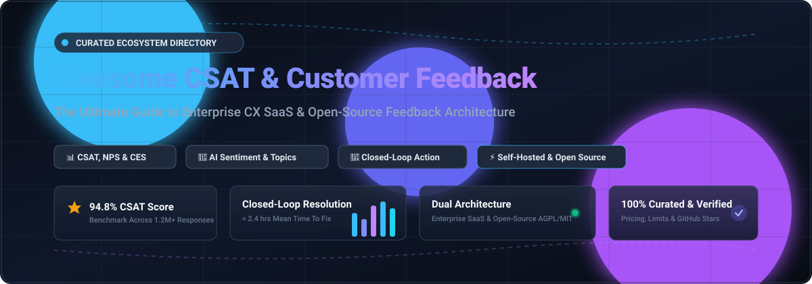
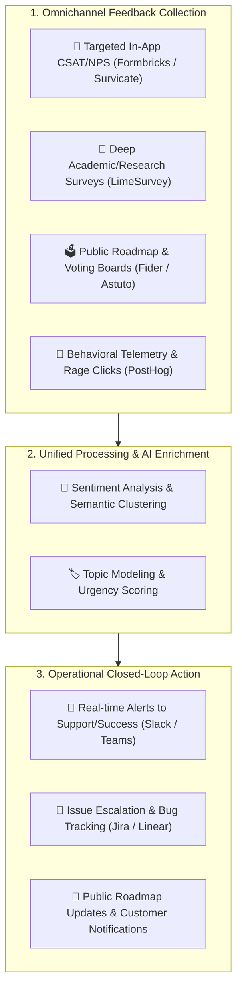

# Awesome CSAT & Customer Feedback Management 🎯

  

  
  
  
  
  
  

---

## 🌟 Top CSAT & Customer Feedback Management Ecosystem

> **A Curated Directory of Enterprise SaaS Solutions & Open-Source Software for Voice of Customer (VoC), CSAT, NPS, CES, Sentiment Analysis, and Closed-Loop Feedback Action.**  
> *Last updated: March 2026* 🚀

Welcome to the definitive, SEO-optimized repository tracking the best **Customer Satisfaction (CSAT)**, **Net Promoter Score (NPS)**, **Customer Effort Score (CES)**, and **Customer Feedback Management (CFM)** tools. Whether you are an enterprise CX executive, product manager, customer success lead, or software architect seeking self-hosted data sovereignty, this guide provides verified pricing, honest free-tier limits, and active open-source repositories to empower your feedback infrastructure. 📊✨

---

## 📑 Table of Contents
- [Sector Overview & Market Dynamics 📈](#sector-overview--market-dynamics-)
- [SaaS / Hosted Experience Management Platforms ☁️](#saas--hosted-experience-management-platforms-️)
- [Open-Source GitHub Projects 🛠️](#open-source-github-projects-️)
- [Strategic Architecture: Building Modern Feedback Loops 💡](#strategic-architecture-building-modern-feedback-loops-)
- [Star History 🌟](#star-history-)
- [Support & Community 💖](#support--community-)
- [How to Contribute 🤝](#how-to-contribute-)
- [Disclaimer ⚖️](#disclaimer-️)

---

## Sector Overview & Market Dynamics 📈

The global Customer Experience Management (CXM) and Customer Feedback Management (CFM) software market is estimated at roughly **$17.5B to $26B+ in 2026** (expanding from ~$14B–$17B in 2024–2025 at an annual compound growth rate of ~14%–16%). The sector is **highly fragmented**, characterized by a sharp division between multi-billion-dollar enterprise experience suites (Qualtrics, Medallia, InMoment) and hundreds of specialized point solutions for in-app micro-surveys, review syndication, conversational AI listening, and product roadmapping rather than a winner-take-all monopoly.

Key industry dynamics shaping customer feedback management include:
- **AI-Native Feedback Unification**: Automated sentiment categorization, semantic embedding clustering, and automatic ticket tagging replacing manual review parsing.
- **Closed-Loop Resolution Workflows**: Instant bidirectional routing to Slack, Linear, Jira, and CRMs to ensure feedback directly drives product fixes.
- **Rise of Open-Source Experience Platforms**: Self-hosted alternatives like Formbricks eliminating prohibitive per-response SaaS fees and guaranteeing compliance with strict data sovereignty regulations (GDPR, HIPAA, SOC 2).

---

## SaaS / Hosted Experience Management Platforms ☁️

The following curated SaaS platforms provide hosted survey delivery, real-time analytics dashboards, and enterprise-grade Voice of Customer integrations. Sorted by company scale in descending order (valuation / revenue):

| Product | Company Scale (Valuation / Revenue) | Description | Starting Pricing | Free Tier / Trial Limits |
|---------|-------------------------------------|-------------|------------------|--------------------------|
| **[Qualtrics CustomerXM](https://www.qualtrics.com/)** 🏢 | **$12.5B valuation** (Acquired by Silver Lake in 2023; ~$1.5B ARR) | Enterprise experience management platform covering omnichannel surveys, text/sentiment analytics, and closed-loop operational workflows. Built for global enterprise CX operations. | **$420/month** (Self-serve Strategic Research, billed annually at $5,040/yr; Enterprise CX contracts start around $30,000/yr) | **Free tier**: 500 lifetime responses, up to 3 active surveys, max 30 questions/survey, 1 user seat, no email distribution. (30-day trial available for Strategic Research). |
| **[Medallia](https://www.medallia.com/)** 🏨 | **$6.4B valuation** (Acquired by Thoma Bravo in 2021; restructured 2026 under private credit consortium; ~$1B revenue scale) | Enterprise feedback management, speech-to-text analytics, and experience intelligence. Widely deployed across hospitality, banking, airlines, and retail. | **$20,000/year** (~$1,666/month, custom enterprise contracts based on annual Experience Data Record / EDR volume) | **Free trial only**: No self-serve free trial or free forever plan; tailored proof-of-concept sandbox environments provisioned strictly via sales scoping. |
| **[SurveyMonkey](https://www.surveymonkey.com/)** 🐒 | **$1.5B valuation** (Acquired by STG in 2023; ~$480M ARR) | World-renowned survey platform with rich CSAT, NPS, and CES templates, automated survey workflows, and comprehensive CRM/marketing integrations. | **$25/user/month** (Team Advantage, billed annually; 3-user minimum = $75/month total) | **Free tier**: 10 questions per survey, 25 viewable responses/month, 7-day data retention, basic question types, no exports. No self-serve trial for paid team plans. |
| **[Typeform](https://www.typeform.com/)** 📝 | **$935M valuation** (Series C; ~$90M–$140M ARR) | Renowned conversational form and survey builder featuring one-question-at-a-time interactive UX designed to maximize completion rates. | **$28/month** (Basic plan, billed annually at $336/yr; $39/month if billed monthly) | **Free tier**: 10 responses/month across all forms, 1 user seat, mandatory Typeform branding. No free trial on standard core plans. |
| **[InMoment](https://inmoment.com/)** 💡 | **$100M+ revenue scale** (Acquired by Press Ganey Forsta in 2025; formerly backed by Madison Dearborn Partners) | Enterprise experience intelligence platform combining multichannel feedback collection, NLP text analytics (Lexalytics), and predictive customer action planning. | **$15,000/year** (~$1,250/month entry custom contract; CoreCX / Wootric micro-survey tiers) | **Free trial only**: 30-day free trial available for CoreCX micro-surveys; enterprise XI suite access requires sales-guided demo/pilot. |
| **[AskNicely](https://www.asknicely.com/)** 💬 | **$47M+ funding raised** (~$10.6M ARR; Series B backed by Five Elms Capital) | Frontline NPS and customer feedback platform focused on employee recognition, real-time service coaching, and automated workflow triggers. | **$399/month** (Learn tier, billed annually; scales with annual response volume) | **Free trial only**: No self-serve free plan or free trial; product demonstrations and pilot evaluations available strictly via sales demo. |
| **[Delighted](https://delighted.com/)** ⚡ | **~$20M+ valuation** (Acquired by Qualtrics; standalone service sunset June 2026 into Qualtrics CoreXM) | Minimalist NPS, CSAT, and CES platform designed for turn-key survey deployment across email, web, SMS, and in-app widgets. | **$19/month** (Starter tier; Premium tier historically at $224/month; now transitioning to Qualtrics tiers) | **Free tier**: 100 responses/month (legacy free plan; 250 response trial). Active users transitioned to Qualtrics free/paid plans. |
| **[Survicate](https://survicate.com/)** 🎯 | **~$4.4M ARR** (~$4.6M funding raised; ~1,600 paying customers) | Versatile feedback survey platform supporting in-product web widgets, mobile SDKs, and email surveys with native HubSpot, Intercom, and Slack sync. | **$56/month** (Starter plan billed annually at $672/yr; $79/month if billed monthly) | **Free tier**: 25 responses/month (up to 300 responses lifetime cap), 3 team seats, standard templates. 10-day free trial of Growth plan features. |
| **[Retently](https://www.retently.com/)** 🔄 | **~$1.7M ARR** (Bootstrapped; independent) | Automated Net Promoter Score (NPS), CSAT, and CES survey automation platform tailored for B2B SaaS and high-volume ecommerce stores. | **$99/month** (Basic plan; 2,500 surveys/month, 3 campaigns, 3 team seats) | **Free trial only**: 14-day free trial of core plans (full access to survey campaigns and integrations; no permanent free plan). |

---

## Open-Source GitHub Projects 🛠️

Self-hosted and open-source feedback platforms give organizations complete control over their customer sentiment data, zero per-response costs, and direct database access. 

The repositories below are **strictly sorted by GitHub Stars_Counts in descending order**:

| Project | Stars_Badge | Description | License / Tech Stack |
|---------|------------|-------------|----------------------|
| **[PostHog](https://github.com/PostHog/posthog)** 🦔 |  | **Open-source product analytics, session replay, and behavioral satisfaction tracking.** While broader than traditional survey platforms, PostHog serves as the leading open-source engine for behavior-based customer satisfaction measurement (capturing rage clicks, drop-offs, and journey friction that surveys fail to record). | MIT / Python, TypeScript, ClickHouse |
| **[Formbricks](https://github.com/formbricks/formbricks)** 🧱 |  | **The category-defining open-source experience management suite and direct alternative to Qualtrics, Medallia, and Typeform.** Provides link surveys, in-app micro-surveys, and website widgets with granular user attribute targeting. Features 20+ question types (CSAT, NPS, CES, matrix), AI sentiment enrichment, feedback unification (Trustpilot, App Store reviews), and webhook integrations. Unlimited responses with zero per-response SaaS fees. | AGPL-3.0 / Next.js, TypeScript, Tailwind |
| **[HeyForm](https://github.com/heyform/heyform)** 📋 |  | **Modern open-source form builder and survey alternative to Typeform and Google Forms.** Features an intuitive drag-and-drop conversational form builder, conditional logic branching, custom themes, data analytics, and rich input types suitable for customer satisfaction and onboarding feedback. | AGPL-3.0 / Node.js, React, TypeScript |
| **[SurveyJS Library](https://github.com/surveyjs/survey-library)** 📊 |  | **Universal open-source JavaScript survey and form engine.** Renders dynamic, JSON-driven multi-step forms, NPS evaluations, quizzes, and CSAT widgets across React, Angular, Vue, and vanilla JavaScript. Connects to any backend database. | MIT / JavaScript, TypeScript |
| **[Fider](https://github.com/getfider/fider)** 🗳️ |  | **Open-source customer feedback and feature request voting platform.** Allows users to submit ideas, upvote proposals, and follow product roadmaps and changelogs. Acts as a lightweight, lightning-fast, self-hostable alternative to Canny and UserVoice. | AGPL-3.0 / Go, React, PostgreSQL |
| **[LimeSurvey](https://github.com/LimeSurvey/LimeSurvey)** 🍋 |  | **The grandmaster of open-source survey tools.** A mature survey and research suite supporting 30+ question types, 80+ international languages, advanced conditional skip logic, quota management, and statistical assessment tools. Free self-hosted deployment with unlimited responses. | GPL-2.0 / PHP, MySQL / PostgreSQL |
| **[TellForm](https://github.com/tellform/tellform)** 📮 |  | **Open-source Typeform alternative for interactive feedback forms.** Create conversational web forms and survey questionnaires with custom CSS, multi-language support, real-time analytics, and webhooks. | MIT / Node.js, AngularJS, MongoDB |
| **[OhMyForm](https://github.com/ohmyform/ohmyform)** 📝 |  | **Community-driven open-source form builder and survey application** (forked and modernized from TellForm). Built for creating beautiful, accessible, and privacy-respecting feedback questionnaires with encrypted responses and API connectivity. | AGPL-3.0 / Node.js, Vue.js, MongoDB |
| **[Astuto](https://github.com/astuto/astuto)** 🦊 |  | **Self-hosted customer feedback management tool.** Allows product teams to gather, organize, and prioritize customer requests, public roadmaps, and release boards. Designed as a clean, open alternative to UserVoice and ProductBoard. | AGPL-3.0 / Ruby on Rails, Vue.js, Docker |
| **[LogChimp](https://github.com/logchimp/logchimp)** 🐵 |  | **Open-source customer feedback tracking software and Canny alternative.** Track customer feedback, prioritize feature requests on interactive boards, and communicate product progress via public roadmaps. | Apache-2.0 / Node.js, Vue.js, PostgreSQL |
| **[ClearFlask](https://github.com/clearflask/clearflask)** 💬 |  | **Open-source client feedback, feature voting, ideation, and roadmap platform.** Features granular permission controls, billing integrations, rich text feedback posts, and customizable feedback portals. | Apache-2.0 / Java, React |
| **[PHPBack](https://github.com/phpback/phpback)** 🐘 |  | **Lightweight PHP and MySQL customer feedback software.** Offers user idea submission, voting boards, moderator status updates, and email notifications for community and web apps. | GPL-3.0 / PHP, MySQL |

---

## Strategic Architecture: Building Modern Feedback Loops 💡

Modern customer satisfaction measurement requires blending structured active surveys with passive telemetry:

- **Active Micro-Surveys**: Use **Formbricks** or **SurveyJS** to trigger targeted CSAT/CES questions at the exact moment of value (e.g., immediately after ticket resolution or checkout).
- **Passive Behavioral Telemetry**: Use **PostHog** to capture silent friction (rage taps, page abandonment) that users never submit via forms.
- **Continuous Closed-Loop Routing**: Pipe sentiment spikes directly into engineering backlogs (Linear/Jira) and frontline coaching channels (Slack) to guarantee action.

---

## Star History 🌟

---

## Support & Community 💖

Thank you for visiting and supporting the **Awesome CSAT & Customer Feedback Management** ecosystem! If this curated collection helps your team, product, or organization improve customer experience, please consider giving it a ⭐ **Star**, 🍴 **Forking**, or sharing it with your network!

Your sponsorship keeps open-source research independent and up-to-date:
- ☕ **Support the Project & Buy a Coffee**: [GitHub Sponsors Dashboard](https://github.com/sponsors/ishandutta2007)
- 💬 **Join our Community Discord**: [Join the Discord Community](https://discord.gg/jc4xtF58Ve)
- 🌐 **Explore More Curated Lists**: [Awesome-Awesome-Awesome](https://github.com/ishandutta2007/Awesome-Awesome-Awesome)

---

## How to Contribute 🤝

1. Fork this repository.
2. Create a descriptive branch (`git checkout -b add-feedback-tool`).
3. Add or update tools in `README.md` maintaining table formatting, specific starting pricing, and exact free-tier limits.
4. For open-source entries, include an official GitHub repository link with the required Stars_Badge (`style=social&color=white`).
5. Submit a Pull Request with a short summary of the addition.

---

## Disclaimer ⚖️

- This repository is a **community-curated index** created for educational, research, and technical comparison purposes. Mention does not constitute an endorsement.
- Customer sentiment and feedback tools process sensitive personal data (PII). Ensure all implementations comply with applicable privacy regulations, including GDPR, CCPA, and HIPAA.
- Software pricing, feature tiers, and limits are verified as of **March 2026** and remain subject to change by respective vendors.

---

  <b>Built for CX Leaders, Product Managers, Customer Success Operations, and Feedback Engineers. 🚀</b> 
  <i>Empowering teams to listen, analyze, and close the loop.</i>

